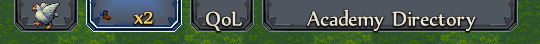
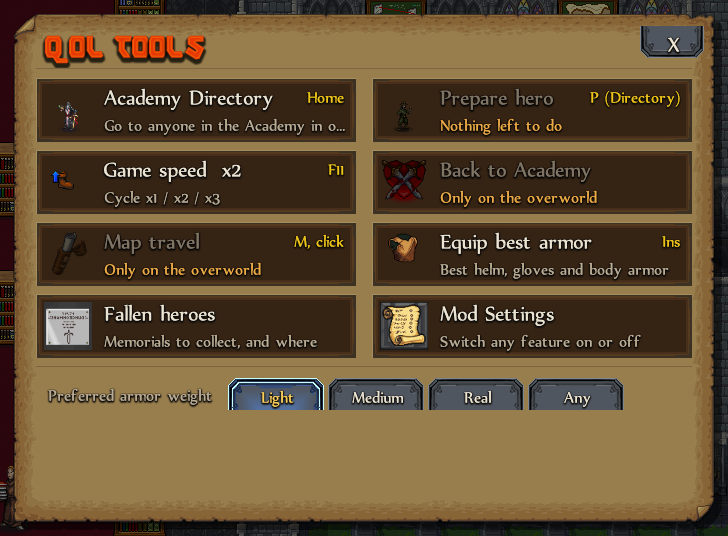

# Overview

Dungeonmans QoL removes clicks and walking from the parts of the game you repeat with every hero. Every feature can be switched off in **Mod Settings**.

## The top bar

The buttons at the top right of the screen hang from the window edge. **Drag one sideways** to change the order; it is remembered. Other mods (like Dungeonmans Poultry) add their buttons to the same bar.

## The QoL hub

Press `End` or click **QoL** to see every tool at once. Tools that don't apply where you are are grayed out, with the reason.

The **Preferred armor weight** row at the bottom is used by Equip best armor.

## Keyboard

In every QoL window, `Tab` and the arrow keys move between buttons, `Enter` or `Space` presses them, and `Esc` closes.
