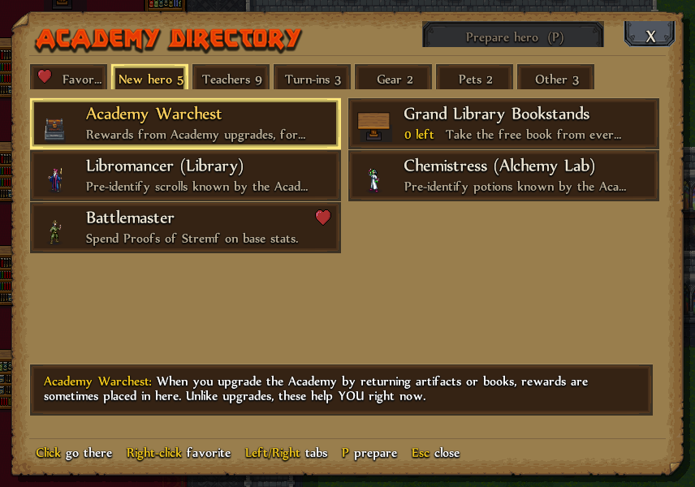

# In the Academy

## Academy Directory

Press `Home` or click **Academy Directory** while in the Academy. Every NPC and station is listed by tab, with what it does. Click an entry and your hero walks up to it and opens it.

- **Right-click** an entry (or click its heart) to pin it to the Favorites tab.
- `Left`/`Right` change tabs, `Enter` goes.

## Prepare hero

The **Prepare hero** button (or `P` in the Directory) does every new-hero chore at once. Hover it to see the list first.

- Identifies your scrolls and potions at the Library and Alchemy Lab (before you first leave the Academy, as in the base game).
- Learns from every ghost teacher you haven't learned from yet.
- Spends your Proofs of Stremf with **preset 1**, if you saved one.
- Tosses the Warchest rewards next to you and empties the Grand Library bookstands.
- Equips your favorite bird: the one with a heart in the Poultry mod, or else the bird your previous hero used.

## Proofs of Stremf (Battlemaster)

- `Shift` + click on `+`/`-`: 10 points at once. `Ctrl` + click: as many as you can.
- **Presets:** `Shift+1/2/3` saves your split, `1/2/3` loads it on a new hero. A preset is a ratio, so it fits any number of Proofs.

## Headmaster

The "give books for the Library" answer disappears at 101 books, when the blacksmith's bonus is already guaranteed.
