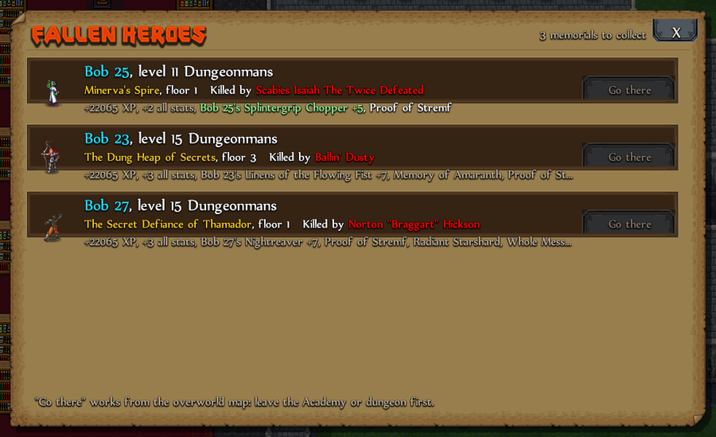

# In dungeons

## Fallen heroes

When a hero dies in a dungeon, a memorial waits on that floor for the next heroes. Touching it gives XP, a bonus to every stat, the Academy items the hero carried and, from level 5, an enchanted copy of their weapon or armor.

Open **Fallen heroes** from the QoL hub or the Gravedigger in the Academy Directory to see every memorial still waiting, where it is and what it gives (hover the rewards line).

**Go there** walks you to the dungeon from the overworld. On the right floor you get a message, and the memorial gets a gold frame once you have seen its tile.

## Getting around and fighting

- **Click to walk:** click any tile more than a step away and your hero walks there. It stops when a monster shows up.
- **Equip best armor:** `Insert`, the QoL hub, or the button on the inventory screen wears your best helm, gloves and body armor of your preferred weight. Right-click the inventory button to change the weight.
- **Fullscreen: Off / No border / Full Fullness** (Options menu): **No border** fills the screen as a borderless window, so alt-tab is instant.
- **Game speed:** `F11` or the speed button cycles x1, x2 and x3. Only animations get faster; the rules don't change.

## Things that stand out

- **Magic pools:** a Dungeon Sense reading shows in green (good) or red (bad), and the pool keeps a colored frame until you drink.
- **Favorite items on the floor:** items of a type you favorite or keep locked get an outline.
